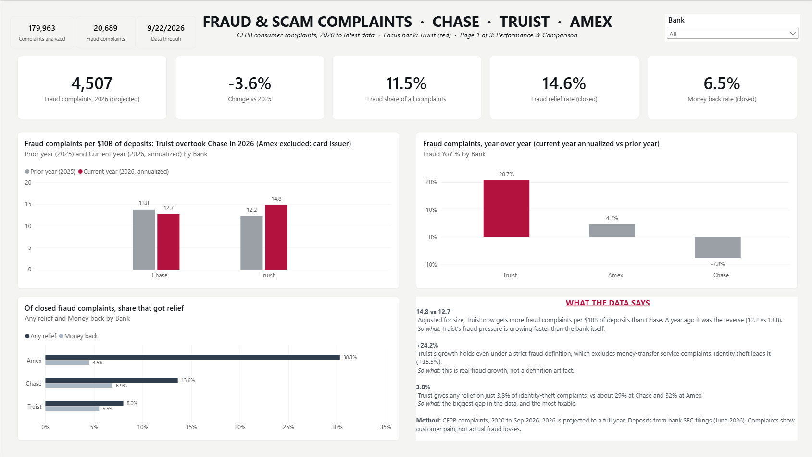
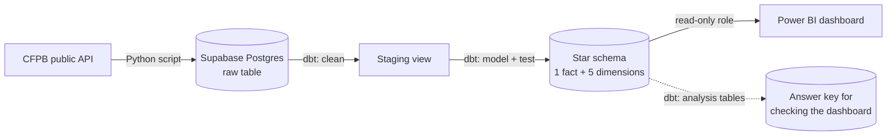
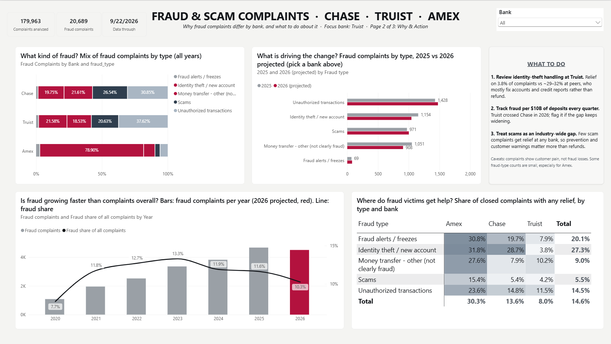
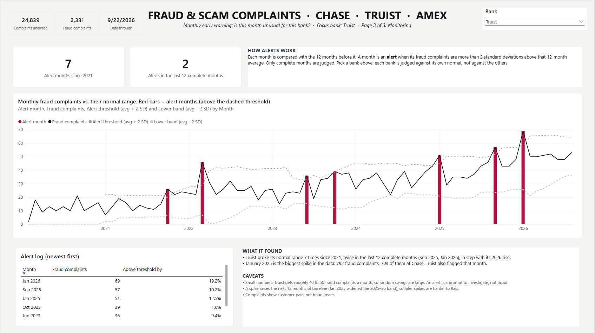

# Bank Fraud & Scam Complaint Analytics

**Which bank's customers are reporting more fraud, once you account for how big each bank is?**

This project answers that question with 180,000 public consumer complaints filed with the U.S. Consumer Financial Protection Bureau (CFPB) about **JPMorgan Chase, Truist and American Express**, from January 2020 to September 2026. It covers the whole path: pulling the raw data, cleaning and modeling it with dbt, testing every step, and presenting the results in a three-page Power BI dashboard.



---

## What I found

**1. Adjusted for size, Truist overtook Chase in 2026.**
Chase receives far more fraud complaints than Truist, but it also holds about 6.6 times more deposits. Comparing raw counts would just tell you Chase is bigger. So I divided fraud complaints by each bank's deposits (from their SEC filings):

| Fraud complaints per $10B of deposits | 2025 | 2026 (projected) |
|---|---|---|
| Chase | 13.8 | 12.7 |
| Truist | 12.2 | **14.8** |

**2. Truist's increase is real fraud, not noise in the definition.**
Even after removing the borderline category (money-transfer complaints that aren't clearly fraud), Truist's fraud complaints are on pace to grow **24%** this year. Identity-theft complaints add the most to that increase (+35%, the largest jump of any type), although unauthorized transactions are still Truist's largest fraud category overall.

**3. Identity-theft victims at Truist rarely get help.**
Of closed identity-theft complaints, **3.8%** at Truist ended with some kind of relief. At Chase it was about 29%, at Amex about 32%.

**4. A monitoring view would have flagged it.**
Comparing each month with the 12 months before it, Truist went above its normal range in 2 of the last 12 complete months (September 2025 and January 2026).

> **Important caveat:** a complaint is a customer telling a regulator something went wrong. It is not a confirmed fraud loss. Treat these numbers as a signal worth investigating, not a verdict on any bank.

---

## How it works



Here is what each step does, in plain terms.

**1. Collect** (`ingestion/ingest_cfpb.py`)
A Python script downloads every complaint about the three banks, one year at a time. Before it touches the database, it checks the data: no duplicate complaint IDs, no missing dates, only the three expected banks, and no year cut off by CFPB's export limit. If any check fails, it stops and nothing is written. When everything passes, it replaces the raw table in a single transaction, so a failed load never leaves you with half the data.

**2. Clean** (`models/staging/`)
The raw data arrives as text, with quirks like the word "nan" where a value should be empty. The staging model turns dates into real dates, IDs into numbers, and those placeholder words into proper empty values.

**3. Model** (`models/marts/core/`)
The cleaned data is reshaped into a **star schema**: one central table with **one row per complaint** (`fct_complaints`), surrounded by lookup tables that describe it: when (`dim_date`), which bank (`dim_company`), which product (`dim_product`), what went wrong (`dim_issue`) and where (`dim_geography`). This shape is what makes the dashboard fast and the numbers easy to slice by any combination of bank, year, fraud type or state.

**4. Present** (`powerbi/`)
Power BI connects through a **read-only database user** that can only see the star schema. All the business calculations (fraud share, relief rates, year-over-year change, size-adjusted rates, monitoring alerts) are written once as DAX measures, so every chart uses the same definition.

---

## Defining "fraud"

CFPB doesn't label complaints as fraud, so I had to decide what counts. A complaint is treated as fraud-related when either:

- its issue matches one of **10 hand-reviewed rules** in [`seeds/fraud_issue_allowlist.csv`](fraud_analytics/seeds/fraud_issue_allowlist.csv) (for example *"Transaction was not authorized"* or *"Account opened without my consent or knowledge"*), or
- it's about a **money transfer or virtual currency** product.

Each fraud complaint also gets a type:

| Fraud type | Complaints |
|---|---|
| Unauthorized transactions | 6,039 |
| Identity theft / new account | 5,326 |
| Scams | 4,894 |
| Money transfer, other (not clearly fraud) | 4,136 |
| Fraud alerts / freezes | 294 |
| **Total** | **20,689** |

The rules live in a small CSV file instead of being buried in SQL. That makes the definition easy to read, easy to change, and visible in the project history whenever someone changes it. The fourth category is labeled honestly as *not clearly fraud*, and the key findings are checked both with and without it.

## Comparing banks fairly

Raw complaint counts mostly reflect bank size, so the size-adjusted view divides fraud complaints by deposits. The deposit figures are period-end values as of June 30, 2026, taken from each bank's quarterly SEC filing, with the source written next to every number in [`seeds/bank_size.csv`](fraud_analytics/seeds/bank_size.csv).

American Express is left out of this one view on purpose. It's mainly a card company, so its deposits understate how many customers it serves, and dividing by them would make it look far worse than it is. Amex is included everywhere else in the dashboard.

## Keeping the numbers honest

A dashboard is only useful if you can trust it, so most of the work went into checking.

- **Tests on every layer.** More than 40 automated dbt tests check things like: every complaint ID is unique, only the expected banks and response types appear, every fraud complaint has a fraud type, and every rule in the fraud definition still matches real complaints (so a renamed CFPB category can't silently drop out).
- **Contracts on the core tables.** The fact table and main dimensions declare their exact columns and data types. If a change doesn't match the declaration, the build stops instead of quietly changing what the dashboard receives.
- **An independent answer key.** Separate SQL analysis tables calculate the key results a second way. Every DAX measure in the dashboard was compared against them, including the totals, before it was used.

These checks caught real mistakes along the way, including a relief-rate measure that was ten times too low and 4,136 fraud complaints that had no category.

---

## The dashboard

| Page | Question it answers |
|---|---|
| **Overview** | How big is fraud, is it growing, and how do the banks compare once size is taken into account? |
| **Why & Action** | What kinds of fraud are driving the change, where do victims get help, and what should a bank look at first? |
| **Monitoring** | Is this month unusual for this bank? Each month is compared with the 12 months before it, and months more than two standard deviations above that average are flagged. |




*Monitoring page filtered to Truist. Use the Bank filter to see any bank against its own normal range.*

The dashboard is saved as a **Power BI Project** (`.pbip`), which stores the report and data model as text files. That means changes to measures and visuals show up in the project history like any other code. The data itself is never committed.

---

## Run it yourself

You'll need Python 3.12, a Postgres database (I used [Supabase](https://supabase.com)'s free tier) and Power BI Desktop for the dashboard.

**1. Set your connection details as environment variables.** Nothing secret is stored in the project files.

```powershell
[Environment]::SetEnvironmentVariable("SUPABASE_HOST", "<your-host>", "User")
[Environment]::SetEnvironmentVariable("SUPABASE_USER", "<your-user>", "User")
[Environment]::SetEnvironmentVariable("SUPABASE_PASSWORD", "<your-password>", "User")
```

Open a new terminal afterwards so it picks them up. (On Mac or Linux, use `export SUPABASE_HOST=...` instead.)

**2. Install the tools.**

```powershell
python -m venv venv
.\venv\Scripts\Activate.ps1
pip install dbt-postgres pandas requests sqlalchemy psycopg2-binary truststore
```

**3. Load the raw data.** Run this on your own computer: CFPB blocks requests from most cloud servers.

```powershell
python ingestion\ingest_cfpb.py --dry-run   # download and check only, writes nothing
python ingestion\ingest_cfpb.py             # download, check and load
```

**4. Build and test everything with dbt.** dbt needs a profile at `~/.dbt/profiles.yml` that reads the same three variables:

```yaml
fraud_analytics:
  target: dev
  outputs:
    dev:
      type: postgres
      host: "{{ env_var('SUPABASE_HOST') }}"
      user: "{{ env_var('SUPABASE_USER') }}"
      pass: "{{ env_var('SUPABASE_PASSWORD') }}"
      port: 5432
      dbname: postgres
      schema: analytics
      threads: 4
```

```powershell
cd fraud_analytics
dbt build
```

`dbt build` loads the reference files, builds every table and runs every test in the right order. If any test fails, the tables that depend on it aren't built.

**5. Open the dashboard.** Open `powerbi/fraud_dashboard.pbip` in Power BI Desktop and sign in to your database when asked. I connect with a separate read-only user (`powerbi_reader`); any user that can read the `analytics` schema works.

---

## Project layout

```
ingestion/
  ingest_cfpb.py            download, validate and load the raw complaints
fraud_analytics/            the dbt project
  models/staging/           cleaning
  models/marts/core/        star schema (fact + dimensions), with contracts and tests
  models/marts/analysis/    answer-key tables used to check the dashboard
  seeds/                    hand-maintained reference data: fraud rules, bank names, deposits
  tests/                    custom data checks
powerbi/
  fraud_dashboard.pbip      the dashboard (open this in Power BI Desktop)
```

## Limitations

- **Complaints aren't losses.** They show where customers felt harmed enough to contact a regulator, not how much fraud actually happened.
- **Bank size is measured one way.** Deposits work well for Chase and Truist but not for a card issuer, which is why Amex is excluded from the size-adjusted view.
- **2026 is projected.** The current year is scaled up from data through September 22 to a full-year pace, which assumes complaints arrive fairly evenly through the year.
- **Small numbers swing.** Truist receives roughly 40 to 50 fraud complaints a month, so single months can move a lot. Monitoring alerts are prompts to look closer, not proof of a problem.

---

Built by **Gonzalo La Chica Maldonado**, M.S. Data Science candidate at Clayton State University.
[Portfolio](https://gonzalolachica.github.io)
